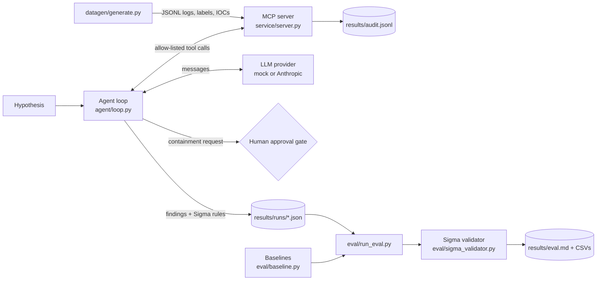

# Features

## Tech stack

| Language / framework / tool | What it is used for here |
|---|---|
| Python 3.12 | All code: data generator, MCP server, agent, eval |
| `mcp` SDK 2.3.0 (FastMCP, async) | The MCP server that exposes the hunting tools over stdio |
| anyio | Runs store queries in worker threads; enforces the wall-time limit with `fail_after` |
| `anthropic` SDK 2.8.0 | The real LLM provider (`claude-opus-5-5`). It is implemented but has not been run, because no API key was available |
| PyYAML 6.0.3 (`safe_load` only) | Parses the Sigma YAML that the server emits so the validator can score it |
| Sigma (subset) | The detection-rule format the agent proposes |
| MITRE ATT&CK | The technique ids used to label the attack chains and tag the rules |
| pytest 9.2.0 | Test suite (`tests/`) |
| ruff 0.17.5 | Lint and format checks |
| Make | Entry points: `venv`, `data`, `test`, `lint`, `hunt`, `eval`, `reproduce` |
| GitHub Actions | CI: lint, tests, then a data + eval smoke run with the mock provider only |

## End-to-end workflow

The generator writes four seeded JSONL logs, a labels file and an IOC feed. The CLI starts the MCP server over
stdio and hands the agent a hypothesis (for example, "SSH brute force against internet-facing servers"). The agent
loop asks the LLM provider (mock or Anthropic) what to do next. It calls read-only tools through the server; each
call is validated, capped and audited. The loop repeats until the model finishes or a budget runs out. Any
containment recommendation passes through the human-approval gate and is only recorded. Findings are checked
for grounding, and the hunt is written to `results/runs/`. The eval runner repeats this for each seed and
hypothesis, alongside two single-prompt baselines. It runs every proposed rule through the Sigma validator over
the full logs and scores the hits against the labels.

## Synthetic log generator

This feature produces the dataset, its ground truth and an IOC feed, with no third-party data. One
`random.Random(seed)` drives everything. Events are sorted by timestamp and only then given ids, so the same seed
always produces byte-identical output. The generator plants four ATT&CK chains with 15 technique steps (14 distinct techniques; T1078 appears in two chains): SSH brute
force to exfiltration; web exploit to web shell to tool transfer; shadow dump to cron to HTTPS beacon; and password
spray to a new local account. It also adds false-positive bait (typo logins, nightly internal backups, benign
HTTPS). Labels are written to a separate `labels.json`, and a test checks that they never leak into the logs.
External addresses come from RFC 5737 documentation ranges. The IOC feed is partial on purpose, so intel alone
cannot solve every hunt. Code: `datagen/generate.py`.

## Read-only MCP server

The server exposes five async tools: `search_logs`, `get_host_timeline`, `lookup_ioc`, `correlate_events` and
`propose_detection_rule`. Logs are loaded once into an in-memory store. Queries run in a worker thread so they
never block the event loop. None of the tools writes anything, and `propose_detection_rule` only drafts a Sigma
rule and dry-runs it with a small matcher. Code: `service/server.py`, `service/store.py`, `service/sigma.py`.

## Tool allow-list

Only the tools named in the allow-list (`--allow` or `ATH_ALLOWED_TOOLS`) are registered, so a disallowed tool
does not exist from the client's point of view. Unknown names in the allow-list make the server fail at startup.
The agent applies its own allow-list check as well, and refused calls are recorded in the agent trace.
Code: `service/server.py`, `agent/loop.py`.

## Input validation, result caps and audit log

Every tool argument is checked before use. Host, user, IP, ATT&CK id and ISO timestamp must match strict patterns;
free text has a length cap and may not contain control characters; `limit` must be between 1 and 200; and rule
fields must exist in the schema for that log type. Failures become tool errors and are audited as `rejected`. A result is capped at 200 events and 60 KB; the tail is
dropped and `truncated: true` is set. Every call appends one JSONL audit record with the time, tool, arguments,
status, size, count, truncation flag and duration. Code: `service/safeguards.py`.

## Agent tool loop with budgets

A hand-written planner-to-tool loop, not the SDK tool runner, sends Anthropic Messages-shaped history to the
provider and executes the tool calls it asks for. Writing the loop by hand keeps the budgets, the gate and the
grounding checks in one place for both providers. It enforces a step limit (LLM calls), a total-token limit and a
wall-time limit (`anyio.fail_after` around every LLM and tool call). The model sees structured results as compact
JSON, capped at 60 K characters. Code: `agent/loop.py`, `agent/cli.py`.

## Human-approval gate

Risky actions are expressed as containment recommendations through an agent-local `request_response_action` tool.
The gate never executes anything; it only records the decision. The policy is `deny` (default), `approve`
(`--approve`) or `prompt` (`--interactive`). Code: `agent/loop.py`.

## Evidence grounding

A finding is marked `verified` only if every event id it cites appeared in a tool result during that hunt.
Fabricated ids are kept in the output but flagged, so a reviewer can see them. This proves that an id was seen,
not that it supports the claim. Code: `agent/loop.py`.

## LLM providers (Anthropic and mock)

Both providers use the Anthropic Messages shape. With `auto`, the Anthropic provider (`claude-opus-5-5`, effort
`medium`, server-side refusal fallback) is used when `ANTHROPIC_API_KEY` is set; it has not been run. The mock
routes on the wording of the hypothesis to one of four scripted playbooks: SSH brute force, web shell,
credential dumping, and password spraying. Every pivot value comes from a tool result, never from the labels.
Code: `agent/llm.py`.

## Single-prompt baselines

The baseline makes one LLM call with no tools. It gets the hypothesis plus a seeded uniform sample of the relevant
logs, filled to the 60 K-character budget of one tool result. Its mock applies the same heuristics as the agent's
mock, with thresholds scaled to the sampling fraction. Its only handicap is that it cannot fetch events it was not
shown. `baseline_matched` is the same baseline with a sample sized to the agent's cumulative input tokens.
Code: `eval/baseline.py`.

## Sigma rule validator

A separate parser checks the YAML the server emits, so the eval scores the artefact an analyst would deploy. It
supports named selections, the `contains`, `startswith`, `endswith` and `re` modifiers plus `all`, wildcards, and
conditions with `and`, `or`, `not`, parentheses and `1 of` / `all of`. Anything else raises `SigmaUnsupported` and names the feature: `base64`, `cidr`, keyword lists, `null`,
`timeframe`, `| count()`, `near` and `logsource.category`. A test checks that the validator agrees with the
server's dry-run matcher on the same rule. Code: `eval/sigma_validator.py`.

## Evaluation runner

For each seed (7, 21, 42), the runner generates fresh data, then hunts each hypothesis in `eval/hypotheses.json`
with all three systems. It scores rule precision and recall (hits of rules tagged `attack.<technique>` over the
full logs), evidence precision, detection (at least one correct cited id), cost (LLM calls, tool calls and
estimated tokens) and wall time. Precision with nothing to score is reported as `n/a`. The output is `results/eval.md`, `eval_techniques.csv` and
`eval_cost.csv`. Code: `eval/run_eval.py`.

## Reproducibility and CI

`make reproduce` wipes `data/`, then runs lint, tests, data generation, the eval and one demo hunt with the mock.
Apart from wall times, the numbers are identical across runs. CI runs ruff, pytest and `make data eval` with
`ANTHROPIC_API_KEY` forced empty, then uploads the eval outputs. Code: `Makefile`, `.github/workflows/ci.yml`.
